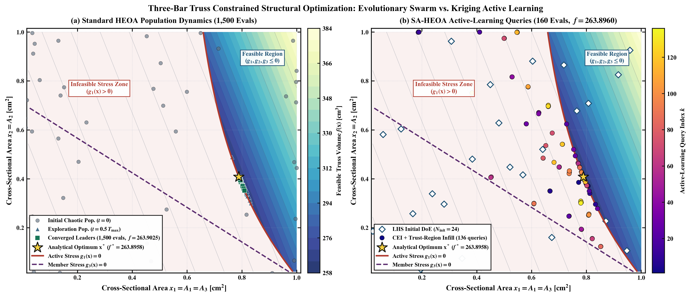
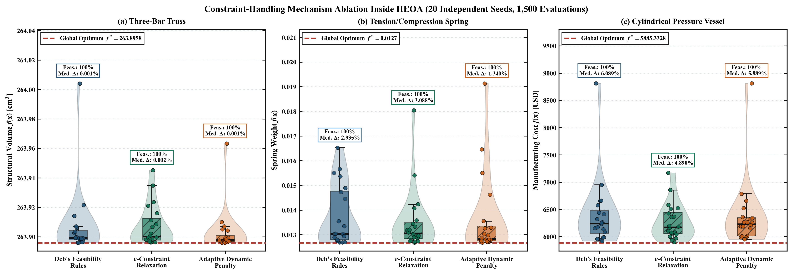
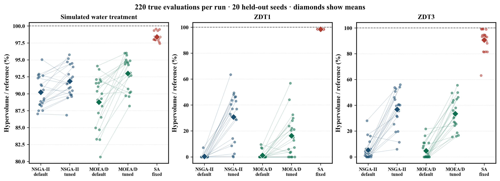

# EvoOpt-Surrogate-Bench

**Constrained Engineering Optimization & Surrogate-Assisted Evolutionary Algorithms (SAEA) in Python & PyTorch**

[](#installation--reproducibility)
[](#2-surrogate-modeling--constrained-infill-criteria)
[](LICENSE)

`EvoOpt-Surrogate-Bench` is a modular, framework connecting **Human Evolutionary Optimization Algorithm (`HEOA`)** and **Multi-Objective Evolutionary Computation (`NSGA-II`, `MOEA/D`, `DE`, `PSO`)** with **Bayesian Kriging (Gaussian Processes) and PyTorch Deep Ensemble Surrogates**.

The benchmark compares objective quality under prespecified evaluation budgets on analytical engineering problems, ZDT functions and a simulated water-treatment case. The original suite uses seeds 0–19. A separate [small-budget experiment](#held-out-small-budget-comparison) tunes both direct multi-objective optimizers on development seeds, then tests all methods on fresh seeds. A true evaluation here is a call on one candidate to the benchmark equations. Surrogate training time and inner-loop evaluations are additional computational costs.

---

## Visual Highlights

### 1. Constrained Structural Design Landscape: Standard `HEOA` vs. `SA-HEOA` Active Learning


### 2. Feasible Objective Gap Across Fixed Evaluation Budgets


### 3. Constrained Environmental Reaction Kinetics ($`\text{O}_3/\text{H}_2\text{O}_2`$ AOP with Bromate Safety Limit) & ZDT Pareto Frontiers


### 4. Constraint-Handling Mechanism Ablation (20 Independent Seeds)


---

## Mathematical Formulations

### 1. Human Evolutionary Optimization Algorithm (`HEOA`)
`HEOA` models human civilization's transition from chaotic environmental exploration to structured role-based societal development:

1. **Logistic Chaotic Initialization**: Initializes a population from logistic-map iterates:

   ```math
   z_{k+1, d} = \mu\, z_{k, d}\,(1 - z_{k, d}), \quad \mu = 4.0, \qquad x_{i, d}^{(0)} = lb_d + z_{i, d}(ub_d - lb_d)
   ```

2. **Human Exploration Phase ($`t / T_{\max} \le \rho_{\text{exp}}`$)**: Combines adaptive global contraction around incumbent $`\mathbf{x}_{\text{best}}`$ with heavy-tailed **Mantegna Lévy flights** ($`\beta = 1.5`$) to escape infeasible/local basins:

   ```math
   \mathbf{x}_i^{(t+1)} = \mathbf{x}_{\text{best}} + \beta_t\!\left(1 - \frac{t}{T_{\max}}\right)(\mathbf{x}_i^{(t)} - \mathbf{x}_{\text{best}}) + \gamma_t\,\mathrm{Levy}(\beta)\odot(\mathbf{x}_{r_1}^{(t)} - \bar{\mathbf{x}}^{(t)})
   ```

3. **Human Development Phase ($`t / T_{\max} \gt \rho_{\text{exp}}`$)**: Stratifies the feasibility-ranked population into four cooperative roles:
   - **Leaders (Top 20%)**: Local exploitation and differential boundary refinement along active nonlinear constraints ($`g_j(\mathbf{x}) = 0`$).
   - **Explorers (Next 30%)**: Lévy-assisted boundary traversal between population centroid $`\bar{\mathbf{x}}`$ and $`\mathbf{x}_{\text{best}}`$.
   - **Followers (Next 30%)**: Adaptive social learning guided by randomly paired Leaders.
   - **Losers (Bottom 20%)**: Eliminated from infeasible regions and regenerated around the elite feasible subspace.

---

### 2. Canonical Constraint-Handling Mechanisms (`evoopt/constraints.py`)
Given $`\min_{\mathbf{x}} f(\mathbf{x})`$ subject to $`g_j(\mathbf{x}) \le 0`$ ($`j = 1, \dots, m`$), total constraint violation is $`\mathrm{CV}(\mathbf{x}) = \sum_{j=1}^m \max(0, g_j(\mathbf{x}))`$:

- **Deb's Parameter-Free Feasibility Rules** (Deb, *CMAME* 2000): Candidate $`\mathbf{x}_a`$ dominates $`\mathbf{x}_b`$ iff: (i) both are feasible ($`\mathrm{CV}=0`$) and $`f(\mathbf{x}_a) \lt f(\mathbf{x}_b)`$; (ii) $`\mathbf{x}_a`$ is feasible and $`\mathbf{x}_b`$ is infeasible; or (iii) both are infeasible and $`\mathrm{CV}(\mathbf{x}_a) \lt \mathrm{CV}(\mathbf{x}_b)`$.
- **$`\epsilon`$-Constraint Relaxation** (Takahama & Sakai, 2006): Relaxes feasibility up to an annealed threshold $`\epsilon(t) = \epsilon_0 (1 - t / T_c)^{c_p}`$ for $`t \lt T_c`$ and $`\epsilon(t) = 0`$ thereafter, allowing smooth traversal across narrow active-constraint necks.
- **Adaptive Dynamic Penalty**: Scales penalty pressure dynamically with objective IQR and search progress $`\lambda(t) = \lambda_0 s_f (1 + \alpha (t / T_{\max})^\beta)`$.

---

### 3. Surrogate Modeling & Constrained Infill Criteria (`evoopt/surrogate.py`)
For expensive black-box objectives and constraints, `EvoOpt-Surrogate-Bench` fits either **ARD Matérn 5/2 Gaussian Process Kriging** or a **Vectorized PyTorch Deep Ensemble** ($`M=5`$ SiLU MLPs trained with bootstrap weighting) to obtain posterior predictive mean $`\hat{\mu}(\mathbf{x})`$ and epistemic uncertainty $`\hat{\sigma}(\mathbf{x})`$:

- **Probability of Feasibility (`PoF`)**:

  ```math
  \mathrm{PoF}(\mathbf{x}) = \prod_{j=1}^{m} \Phi\!\left(\frac{-\hat{\mu}_{g_j}(\mathbf{x})}{\hat{\sigma}_{g_j}(\mathbf{x})}\right)
  ```

- **Constrained Expected Improvement (`CEI`)**:

  ```math
  \mathrm{CEI}(\mathbf{x}) = \mathrm{EI}(\mathbf{x}) \times \mathrm{PoF}(\mathbf{x}), \qquad \mathrm{EI}(\mathbf{x}) = (f_{\min}^{\text{feas}} - \hat{\mu}_f(\mathbf{x}))\,\Phi(Z) + \hat{\sigma}_f(\mathbf{x})\,\phi(Z)
  ```

- **Feasibility-Aware Multi-Objective Lower Confidence Bound (`SA-NSGA-II`)**:

  ```math
  \tilde{f}_k(\mathbf{x}) = \hat{\mu}_{f_k}(\mathbf{x}) - \kappa(t)\,\hat{\sigma}_{f_k}(\mathbf{x}), \qquad \tilde{g}_j(\mathbf{x}) = \hat{\mu}_{g_j}(\mathbf{x}) + \beta(t)\,\hat{\sigma}_{g_j}(\mathbf{x}) \le 0
  ```

---

## AI4Science Case Study: Peroxone ($`\text{O}_3/\text{H}_2\text{O}_2`$) AOP Reaction Kinetics

In `evoopt.problems.AOPOzonationKineticsMOO`, we model advanced oxidation water treatment of recalcitrant pharmaceutical micropollutants in bromide-containing surface water across $`D = 4`$ reactor operating parameters ($`\mathrm{pH} \in [5.5, 9.0]`$, applied ozone $`[\text{O}_3]_0 \in [0.8, 12.0]\;\text{mg/L}`$, molar ratio $`r_{\text{H}_2\text{O}_2/\text{O}_3} \in [0.0, 1.2]`$, and hydraulic retention time $`t \in [2.0, 30.0]\;\text{min}`$):

- **Objective 1**: Minimize residual micropollutant fraction $`f_1(\mathbf{x}) = 1 - \eta(\mathbf{x}) = C_t / C_0`$.
- **Objective 2**: Minimize Electrical & Oxidant Energy per Order $`f_2(\mathbf{x}) = \mathrm{EE/O}(\mathbf{x})`$ ($`\text{kWh}\cdot\text{m}^{-3}\cdot\text{order}^{-1}`$).
- **Model bromate constraint**: $`[\text{BrO}_3^-](\mathbf{x}) \le 10.0\;\mu\text{g/L}`$, alongside minimum removal $`\eta(\mathbf{x}) \ge 65\%`$ and effluent residual peroxide $`[\text{H}_2\text{O}_2]_{\text{res}} \le 3.5\;\text{mg/L}`$.

The AOP equations model residual contaminant, energy use and effluent bromate as functions of four operating variables. The reference front is a numerical grid with local refinement. Model outputs illustrate algorithm behavior. Applying these estimates to an actual water matrix would require experimental calibration.

---

## Experimental Results (20 Independent Random Seeds)

> Benchmark metrics generated by `scripts/run_benchmarks.py` (`results/engineering_opt_benchmark.json` and `results/pareto_metrics.csv`).

### Table 1. Constrained structural benchmarks

Feasibility is the percentage of seeds returning at least one feasible design. The objective and gap statistics use only those feasible seeds. The pressure vessel uses continuous thicknesses. The last column compares the median result with the benchmark reference optimum.

| Problem | Algorithm | Evaluation budget | Feasibility | Best objective | Median objective | Mean ± SD | Median relative gap |
|---|---|---:|---:|---:|---:|---:|---:|
| Three-Bar Truss (f* = 263.895843) | SA-HEOA | 160 | 100% | 263.895863 | 263.896310 | 263.896520 ± 0.000625 | 0.0002% |
|  | SA-HEOA-DEns | 180 | 100% | 263.900761 | 264.117008 | 264.242726 ± 0.321815 | 0.0838% |
|  | HEOA | 1,500 | 100% | 263.895964 | 263.899342 | 263.906699 ± 0.023209 | 0.0013% |
|  | DE | 1,500 | 100% | 263.896227 | 263.899655 | 263.900447 ± 0.004284 | 0.0014% |
|  | PSO | 1,500 | 100% | 263.901527 | 263.937309 | 263.969068 ± 0.071835 | 0.0157% |
| Tension/Compression Spring (f* = 0.012665) | SA-HEOA | 160 | 100% | 0.012674 | 0.013047 | 0.013634 ± 0.001272 | 3.0176% |
|  | SA-HEOA-DEns | 180 | 95% | 0.013149 | 0.019285 | 0.019807 ± 0.006170 | 52.2678% |
|  | HEOA | 1,500 | 100% | 0.012686 | 0.013037 | 0.013768 ± 0.001207 | 2.9347% |
|  | DE | 1,500 | 100% | 0.012767 | 0.013227 | 0.013303 ± 0.000377 | 4.4382% |
|  | PSO | 1,500 | 100% | 0.012949 | 0.013724 | 0.013958 ± 0.000846 | 8.3584% |
| Pressure Vessel (f* = 5885.332774) | SA-HEOA | 160 | 100% | 5936.163423 | 6086.522783 | 6088.681075 ± 109.274603 | 3.4185% |
|  | SA-HEOA-DEns | 180 | 100% | 5961.907642 | 7026.121998 | 7216.634373 ± 803.680804 | 19.3836% |
|  | HEOA | 1,500 | 100% | 5921.203458 | 6243.686697 | 6397.509294 ± 617.413957 | 6.0889% |
|  | DE | 1,500 | 100% | 6440.127577 | 6913.866809 | 6910.687196 ± 262.889532 | 17.4762% |
|  | PSO | 1,500 | 100% | 6165.053138 | 6606.159252 | 6699.772726 ± 339.792284 | 12.2478% |

### Table 2. Constraint handling in HEOA

Each configuration has a budget of 1,500 evaluations per seed.

| Problem | Constraint handler | Feasibility | Best objective | Median objective | Mean ± SD | Median relative gap |
|---|---|---:|---:|---:|---:|---:|
| Three-Bar Truss | Deb's Feasibility Rules | 100% | 263.895964 | 263.899342 | 263.906699 ± 0.023209 | 0.0013% |
|  | Epsilon-Constraint | 100% | 263.896173 | 263.900200 | 263.907337 ± 0.013739 | 0.0017% |
|  | Adaptive Penalty | 100% | 263.895964 | 263.897951 | 263.902587 ± 0.014452 | 0.0008% |
| Tension/Compression Spring | Deb's Feasibility Rules | 100% | 0.012686 | 0.013037 | 0.013768 ± 0.001207 | 2.9347% |
|  | Epsilon-Constraint | 100% | 0.012682 | 0.013056 | 0.013495 ± 0.001228 | 3.0879% |
|  | Adaptive Penalty | 100% | 0.012680 | 0.012835 | 0.013610 ± 0.001615 | 1.3398% |
| Pressure Vessel | Deb's Feasibility Rules | 100% | 5921.203458 | 6243.686697 | 6397.509294 ± 617.413957 | 6.0889% |
|  | Epsilon-Constraint | 100% | 5902.631216 | 6173.115297 | 6277.142908 ± 320.233202 | 4.8898% |
|  | Adaptive Penalty | 100% | 5953.096912 | 6231.919396 | 6362.805579 ± 604.923714 | 5.8890% |

### Table 3. Multi-objective benchmarks under fixed and matched budgets

Higher hypervolume (HV) and lower inverted generational distance (IGD) indicate better approximation of the reference front. IGD uses the unscaled objectives. Each baseline retains population size 80 at both budgets, so 220 evaluations permit fewer than three full population evaluations. The ratios of budgets (e.g. 220/2,400) describe the design of this comparison. Time or evaluations to a common performance target were not measured.

| Problem | Algorithm | Evaluation budget | HV mean ± SD | Mean HV / reference HV | IGD mean ± SD | Feasible runs |
|---|---|---:|---:|---:|---:|---:|
| AOP Ozonation Kinetics MOO | NSGA-II | 2,400 | 0.090692 ± 0.000891 | 97.56% | 0.004541 ± 0.001295 | 100% |
|  | MOEA/D | 2,400 | 0.091839 ± 0.000509 | 98.79% | 0.004098 ± 0.001350 | 100% |
|  | NSGA-II | 220 | 0.083358 ± 0.002007 | 89.67% | 0.031090 ± 0.011743 | 100% |
|  | MOEA/D | 220 | 0.083843 ± 0.002260 | 90.19% | 0.027066 ± 0.007806 | 100% |
|  | SA-NSGA-II | 220 | 0.091320 ± 0.000529 | 98.23% | 0.006461 ± 0.003555 | 100% |
| ZDT1 | NSGA-II | 2,400 | 0.821481 ± 0.016041 | 93.93% | 0.034476 ± 0.012119 | 100% |
|  | MOEA/D | 2,400 | 0.801707 ± 0.023444 | 91.66% | 0.042888 ± 0.015626 | 100% |
|  | NSGA-II | 220 | 0.008128 ± 0.020094 | 0.93% | 1.080015 ± 0.228202 | 100% |
|  | MOEA/D | 220 | 0.005658 ± 0.018133 | 0.65% | 1.268980 ± 0.313389 | 100% |
|  | SA-NSGA-II | 220 | 0.861587 ± 0.001870 | 98.51% | 0.009170 ± 0.001093 | 100% |
| ZDT3 | NSGA-II | 2,400 | 1.234083 ± 0.062597 | 92.73% | 0.040291 ± 0.027039 | 100% |
|  | MOEA/D | 2,400 | 1.224567 ± 0.037544 | 92.02% | 0.039793 ± 0.016138 | 100% |
|  | NSGA-II | 220 | 0.052611 ± 0.064966 | 3.95% | 1.006148 ± 0.173753 | 100% |
|  | MOEA/D | 220 | 0.032584 ± 0.055567 | 2.45% | 1.156377 ± 0.238065 | 100% |
|  | SA-NSGA-II | 220 | 1.209874 ± 0.143637 | 90.91% | 0.059202 ± 0.073957 | 100% |

At 220 evaluations, the AOP model's mean HV ratio was 98.23% for SA-NSGA-II, 89.67% for NSGA-II and 90.19% for MOEA/D. At 2,400 evaluations MOEA/D reached 98.79% and a lower mean IGD (0.004098 vs. 0.006461 for SA-NSGA-II).

The representative simulated knee point (SA-NSGA-II, seed 0, 220 evaluations) used pH 8.502, ozone 2.706 mg/L, peroxide-to-ozone molar ratio 0.651 and residence time 18.69 min. The model predicted 90.10% removal, EE/O 0.0786 kWh m⁻³ order⁻¹ and bromate 9.923 µg/L.

### Held-out small-budget comparison

For each of the three problems, NSGA-II and MOEA/D entered the same number of candidates: their original population-80 configuration and 12 small-population configurations. Both searched populations of 10, 20 and 40 and polynomial mutation distribution indices of 5 and 20. NSGA-II also varied the crossover distribution index (5 or 20). MOEA/D varied the mating neighborhood (25% or 75% of the population, rounded down with a minimum of three). Each algorithm retained its native initialization and operators. SA-NSGA-II kept the original 40-point Latin hypercube and original infill settings.

The selection score was mean feasible-front hypervolume over eight development seeds (100–107), with zero hypervolume for an empty feasible front. Selection was performed separately for each direct optimizer and problem. The frozen configurations, both defaults and SA-NSGA-II were then run on the same 20 held-out seeds (1000–1019). Every optimization run consumed exactly 220 true candidate evaluations. Tuning cost 137,280 evaluations (624 runs); the held-out comparison cost another 66,000 (300 runs). These totals exclude reference-front construction and surrogate computation.



| Problem | NSGA-II default → tuned | MOEA/D default → tuned | SA-NSGA-II fixed | SA minus stronger tuned baseline, pp (95% interval) |
| --- | ---: | ---: | ---: | ---: |
| Simulated AOP | 90.22 → 91.86 | 88.77 → 93.00 | 98.37 | +5.37 [4.32, 6.44] |
| ZDT1, 8-D | 0.36 → 30.71 | 1.16 → 16.34 | 98.48 | +67.77 [59.91, 75.88] |
| ZDT3, 8-D | 5.33 → 36.81 | 4.68 → 33.52 | 90.65 | +53.84 [47.69, 60.35] |

Values in the three algorithm columns are mean percentages of the problem-specific reference hypervolume. The last column uses the tuned baseline with the higher held-out mean, selected for display; the artifact reports both prespecified pairwise contrasts. Intervals are percentile intervals from 10,000 paired resamples of the 20 test seeds, conditional on the selected configurations. Every run returned a feasible front. The fixed surrogate method exceeded both tuned baselines on HV for each of the 20 test seeds on each problem.

The hypervolume metric only credits feasible points that improve on the reference point in both objectives. On ZDT1, 19/20 default NSGA-II runs and 17/20 default MOEA/D runs had zero HV despite returning feasible points. Tuning reduced those counts to 1/20 and 5/20. The unscaled IGD also improved, from 1.16785 to 0.45779 for NSGA-II and from 1.28172 to 0.71978 for MOEA/D.

On AOP, the selected NSGA-II used population 40 with crossover and mutation indices of 5. MOEA/D used population 20, neighborhood size 15 and mutation index 5. Their mean IGDs were 0.02019 and 0.01843, compared with 0.00514 for SA-NSGA-II. Giving the direct baselines more generations improved both; the remaining difference supports better front approximation by this surrogate configuration at 220 true evaluations on these three functions. Additional optimizer families, wall-clock efficiency, real process performance and costs to reach a common target remain open.

ZDT1 and ZDT3 share an axis-aligned optimum: the last seven decision variables approach zero on the Pareto set. Across the 20 held-out seeds, 97.8% of the surrogate method's returned ZDT1 points and 96.1% of its ZDT3 points had a mean below 0.01 across those coordinates. These results establish performance on a shared geometry. Rotated or interior optima would test a different capability. On seed 1000 for each of the three problems, the 220 true evaluations were accompanied by 10,920 surrogate candidate evaluations.

[Per-seed metrics, held-out front coordinates, candidate grid and selection scores](results/small_budget_tuning.json)

---

## Repository Architecture

```text
EvoOpt-Surrogate-Bench/
├── evoopt/
│   ├── __init__.py          # Public package exports
│   ├── problems.py          # 3-Bar Truss, Spring, Pressure Vessel, Welded Beam, AOP Ozonation, ZDT1-3, OSY
│   ├── constraints.py       # Deb's Feasibility Rules, Adaptive Penalty, Epsilon-Constraint
│   ├── optimizers.py        # Vectorized HEOA, DE, PSO, NSGA-II, MOEA/D
│   ├── surrogate.py         # Matérn 5/2 Kriging, PyTorch Deep Ensemble, CEI/PoF/LCB, SA-HEOA, SA-NSGA-II
│   └── metrics.py           # Exact sweep-line Hypervolume, IGD, Pareto efficiency, Knee-Point finder
├── scripts/
│   ├── run_benchmarks.py    # 20-seed statistical evaluation & constraint ablation runner
│   ├── tune_small_budget.py # Select and evaluate budget-specific direct baselines
│   └── generate_figures.py  # Generates benchmark figures in assets/
├── tests/
│   └── test_evoopt.py       # Full pytest suite (optima, dominance, HV/IGD, HEOA, SAEA budgets)
├── results/                 # Reproducible JSON, CSV, and trajectory archives
├── assets/                  # Publication-grade 300-DPI figures
├── pyproject.toml
├── requirements.txt
└── LICENSE
```

---

## Installation & Reproducibility

```bash
pip install -e .[dev]

# 1. Run unit & integration test suite
pytest tests/test_evoopt.py -v

# 2. Execute 20-seed single-objective, ablation, and multi-objective benchmarks
python scripts/run_benchmarks.py

# 3. Tune direct baselines and run the held-out 220-evaluation experiment
python scripts/tune_small_budget.py

# 4. Generate 300-DPI benchmark figures in assets/
python scripts/generate_figures.py
```

## Quick Python API Usage

```python
import evoopt as eo

# 1. Surrogate-Assisted HEOA on Constrained Three-Bar Truss (160 true evaluations)
problem = eo.ThreeBarTruss()
sa_heoa = eo.SurrogateAssistedHEOA(max_evals=160, surrogate_type="gp", seed=42)
res = sa_heoa.optimize(problem)
print(f"Best feasible volume: {res.f_best:.6f} (f* = {problem.f_opt:.6f}) in {res.n_evals} evals")

# 2. Surrogate-Assisted NSGA-II on Bromate-Constrained AOP Ozonation Kinetics (220 evaluations)
aop = eo.AOPOzonationKineticsMOO()
sa_nsga2 = eo.SurrogateAssistedNSGA2(max_evals=220, seed=42)
moo_res = sa_nsga2.optimize(aop)
knee_idx = eo.find_knee_point(moo_res.F_pareto)
print("Knee-Point Reactor Diagnostics:", aop.evaluate_diagnostics(moo_res.X_pareto[knee_idx]))
```

## License

Released under the [MIT License](LICENSE).
