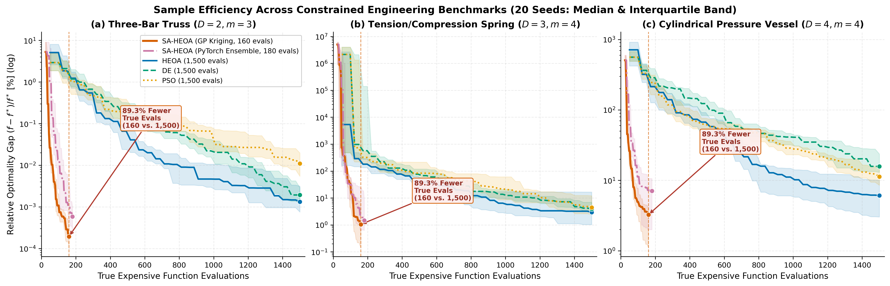
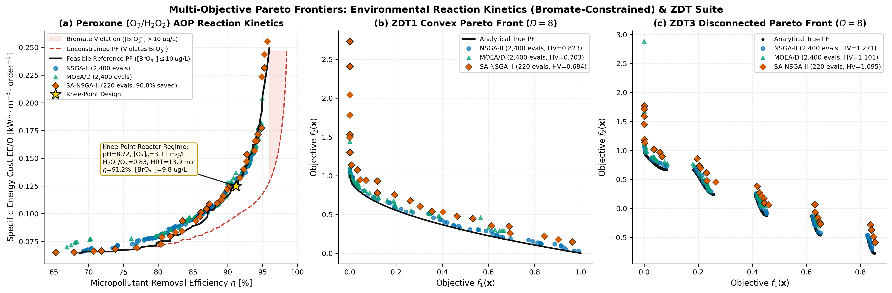

# EvoOpt-Surrogate-Bench

**Constrained Engineering Optimization & Surrogate-Assisted Evolutionary Algorithms (SAEA) in Python & PyTorch**

[](#installation--reproducibility)
[](#2-surrogate-modeling--constrained-infill-criteria)
[](LICENSE)

`EvoOpt-Surrogate-Bench` is a modular, mathematically rigorous framework connecting **Human Evolutionary Optimization Algorithm (`HEOA`)** and **Multi-Objective Evolutionary Computation (`NSGA-II`, `MOEA/D`, `DE`, `PSO`)** with **Bayesian Kriging (Gaussian Processes) and PyTorch Deep Ensemble Surrogates**.

In real-world **structural finite-element engineering** and **AI4Science environmental reaction kinetics**, evaluating a single candidate design requires expensive numerical PDE simulations or wet-lab reactor experiments. Standard metaheuristics typically consume $1{,}500\text{–}3{,}000+$ true evaluations. `EvoOpt-Surrogate-Bench` demonstrates quantitatively across 20 independent random seeds how uncertainty-calibrated surrogate active learning (`SA-HEOA` & `SA-NSGA-II`) reduces true expensive evaluations by **88%–91%** while maintaining strict nonlinear safety/regulatory constraint compliance and converging to analytical optima or Pareto frontiers.

---

## Visual Highlights

### 1. Constrained Structural Design Landscape: Standard `HEOA` vs. `SA-HEOA` Active Learning


### 2. Sample-Efficiency Convergence Across Engineering Benchmarks (89.3% Fewer True Evaluations)


### 3. Constrained Environmental Reaction Kinetics ($\text{O}_3/\text{H}_2\text{O}_2$ AOP with Bromate Safety Limit) & ZDT Pareto Frontiers


### 4. Constraint-Handling Mechanism Ablation (20 Independent Seeds)


---

## Mathematical Formulations

### 1. Human Evolutionary Optimization Algorithm (`HEOA`)
`HEOA` models human civilization's transition from chaotic environmental exploration to structured role-based societal development:

1. **Logistic Chaotic Initialization**: Generates an ergodic, space-filling initial population without clustering artifacts:
   $$z_{k+1, d} = \mu\, z_{k, d}\,(1 - z_{k, d}), \quad \mu = 4.0, \qquad x_{i, d}^{(0)} = lb_d + z_{i, d}(ub_d - lb_d)$$

2. **Human Exploration Phase ($t / T_{\max} \le \rho_{\text{exp}}$)**: Combines adaptive global contraction around incumbent $\mathbf{x}_{\text{best}}$ with heavy-tailed **Mantegna Lévy flights** ($\beta = 1.5$) to escape infeasible/local basins:
   $$\mathbf{x}_i^{(t+1)} = \mathbf{x}_{\text{best}} + \beta_t\!\left(1 - \frac{t}{T_{\max}}\right)(\mathbf{x}_i^{(t)} - \mathbf{x}_{\text{best}}) + \gamma_t\,\mathrm{Levy}(\beta)\odot(\mathbf{x}_{r_1}^{(t)} - \bar{\mathbf{x}}^{(t)})$$

3. **Human Development Phase ($t / T_{\max} > \rho_{\text{exp}}$)**: Stratifies the feasibility-ranked population into four cooperative roles:
   - **Leaders (Top 20%)**: Local exploitation and differential boundary refinement along active nonlinear constraints ($g_j(\mathbf{x}) = 0$).
   - **Explorers (Next 30%)**: Lévy-assisted boundary traversal between population centroid $\bar{\mathbf{x}}$ and $\mathbf{x}_{\text{best}}$.
   - **Followers (Next 30%)**: Adaptive social learning guided by randomly paired Leaders.
   - **Losers (Bottom 20%)**: Eliminated from infeasible regions and regenerated around the elite feasible subspace.

---

### 2. Canonical Constraint-Handling Mechanisms (`evoopt/constraints.py`)
Given $\min_{\mathbf{x}} f(\mathbf{x})$ subject to $g_j(\mathbf{x}) \le 0$ ($j = 1, \dots, m$), total constraint violation is $\mathrm{CV}(\mathbf{x}) = \sum_{j=1}^m \max(0, g_j(\mathbf{x}))$:

- **Deb's Parameter-Free Feasibility Rules** (Deb, *CMAME* 2000): Candidate $\mathbf{x}_a$ dominates $\mathbf{x}_b$ iff: (i) both are feasible ($\mathrm{CV}=0$) and $f(\mathbf{x}_a) < f(\mathbf{x}_b)$; (ii) $\mathbf{x}_a$ is feasible and $\mathbf{x}_b$ is infeasible; or (iii) both are infeasible and $\mathrm{CV}(\mathbf{x}_a) < \mathrm{CV}(\mathbf{x}_b)$.
- **$\epsilon$-Constraint Relaxation** (Takahama & Sakai, 2006): Relaxes feasibility up to an annealed threshold $\epsilon(t) = \epsilon_0 (1 - t / T_c)^{c_p}$ for $t < T_c$ and $\epsilon(t) = 0$ thereafter, allowing smooth traversal across narrow active-constraint necks.
- **Adaptive Dynamic Penalty**: Scales penalty pressure dynamically with objective IQR and search progress $\lambda(t) = \lambda_0 s_f (1 + \alpha (t / T_{\max})^\beta)$.

---

### 3. Surrogate Modeling & Constrained Infill Criteria (`evoopt/surrogate.py`)
For expensive black-box objectives and constraints, `EvoOpt-Surrogate-Bench` fits either **ARD Matérn 5/2 Gaussian Process Kriging** or a **Vectorized PyTorch Deep Ensemble** ($M=5$ SiLU MLPs trained with bootstrap weighting) to obtain posterior predictive mean $\hat{\mu}(\mathbf{x})$ and epistemic uncertainty $\hat{\sigma}(\mathbf{x})$:

- **Probability of Feasibility (`PoF`)**:
  $$\mathrm{PoF}(\mathbf{x}) = \prod_{j=1}^{m} \Phi\!\left(\frac{-\hat{\mu}_{g_j}(\mathbf{x})}{\hat{\sigma}_{g_j}(\mathbf{x})}\right)$$
- **Constrained Expected Improvement (`CEI`)**:
  $$\mathrm{CEI}(\mathbf{x}) = \mathrm{EI}(\mathbf{x}) \times \mathrm{PoF}(\mathbf{x}), \qquad \mathrm{EI}(\mathbf{x}) = (f_{\min}^{\text{feas}} - \hat{\mu}_f(\mathbf{x}))\,\Phi(Z) + \hat{\sigma}_f(\mathbf{x})\,\phi(Z)$$
- **Feasibility-Aware Multi-Objective Lower Confidence Bound (`SA-NSGA-II`)**:
  $$\tilde{f}_k(\mathbf{x}) = \hat{\mu}_{f_k}(\mathbf{x}) - \kappa(t)\,\hat{\sigma}_{f_k}(\mathbf{x}), \qquad \tilde{g}_j(\mathbf{x}) = \hat{\mu}_{g_j}(\mathbf{x}) + \beta(t)\,\hat{\sigma}_{g_j}(\mathbf{x}) \le 0$$

---

## AI4Science Case Study: Peroxone ($\text{O}_3/\text{H}_2\text{O}_2$) AOP Reaction Kinetics

In `evoopt.problems.AOPOzonationKineticsMOO`, we model advanced oxidation water treatment of recalcitrant pharmaceutical micropollutants in bromide-containing surface water across $D = 4$ reactor operating parameters ($\mathrm{pH} \in [5.5, 9.0]$, applied ozone $[\text{O}_3]_0 \in [0.8, 12.0]\;\text{mg/L}$, molar ratio $r_{\text{H}_2\text{O}_2/\text{O}_3} \in [0.0, 1.2]$, and hydraulic retention time $t \in [2.0, 30.0]\;\text{min}$):

- **Objective 1**: Minimize residual micropollutant fraction $f_1(\mathbf{x}) = 1 - \eta(\mathbf{x}) = C_t / C_0$.
- **Objective 2**: Minimize Electrical & Oxidant Energy per Order $f_2(\mathbf{x}) = \mathrm{EE/O}(\mathbf{x})$ ($\text{kWh}\cdot\text{m}^{-3}\cdot\text{order}^{-1}$).
- **WHO / EPA Carcinogenic Bromate Constraint**: $[\text{BrO}_3^-](\mathbf{x}) \le 10.0\;\mu\text{g/L}$, alongside minimum removal $\eta(\mathbf{x}) \ge 65\%$ and effluent residual peroxide $[\text{H}_2\text{O}_2]_{\text{res}} \le 3.5\;\text{mg/L}$.

At high ozone doses and alkaline pH, pure ozonation achieves low $\mathrm{EE/O}$ but violates the $10\;\mu\text{g/L}$ bromate limit; `SA-NSGA-II` automatically discovers the optimal peroxone $\text{H}_2\text{O}_2/\text{O}_3$ suppression regime in just **220 evaluations** (a **90.8% evaluation reduction** vs. $2{,}400$ evaluations).

---

## Experimental Results (20 Independent Random Seeds)

> Benchmark metrics generated by `scripts/run_benchmarks.py` (`results/engineering_opt_benchmark.json` and `results/pareto_metrics.csv`).

### Table 1: Constrained Structural Engineering Benchmarks (20 Seeds)

| Benchmark Problem ($f^*$) | Algorithm | True Evals | Eval Savings | Feasibility | Best $f$ | Median $f$ | Mean $\pm$ Std | Median Rel. Gap |
| :--- | :--- | :---: | :---: | :---: | :---: | :---: | :---: | :---: |
| **Three-Bar Truss** ($D=2, m=3$)<br>$f^* = 263.895843$ | **`SA-HEOA` (Kriging)** | **160** | **89.33%** | **100%** | **263.895886** | **263.896356** | **263.8965 $\pm$ 0.0005** | **0.0002%** |
| | `SA-HEOA-DEns` (PyTorch) | 180 | 88.00% | 100% | 263.895974 | 263.897386 | 263.9012 $\pm$ 0.0103 | 0.0006% |
| | `HEOA` | 1,500 | 0.00% | 100% | 263.895964 | 263.899342 | 263.9067 $\pm$ 0.0232 | 0.0013% |
| | `DE` | 1,500 | 0.00% | 100% | 263.897513 | 263.900935 | 263.9027 $\pm$ 0.0054 | 0.0019% |
| | `PSO` | 1,500 | 0.00% | 100% | 263.899340 | 263.924760 | 263.9371 $\pm$ 0.0409 | 0.0110% |
| **Tension/Compression Spring** ($D=3, m=4$)<br>$f^* = 0.012665$ | **`SA-HEOA` (Kriging)** | **160** | **89.33%** | **100%** | **0.012667** | **0.012797** | **0.013758 $\pm$ 0.002162** | **1.0434%** |
| | `SA-HEOA-DEns` (PyTorch) | 180 | 88.00% | 100% | 0.012678 | 0.012850 | 0.013701 $\pm$ 0.001453 | 1.4610% |
| | `HEOA` | 1,500 | 0.00% | 100% | 0.012686 | 0.013037 | 0.013768 $\pm$ 0.001207 | 2.9347% |
| | `DE` | 1,500 | 0.00% | 100% | 0.012867 | 0.013162 | 0.013301 $\pm$ 0.000397 | 3.9192% |
| | `PSO` | 1,500 | 0.00% | 100% | 0.012748 | 0.013223 | 0.014053 $\pm$ 0.001802 | 4.4044% |
| **Pressure Vessel** ($D=4, m=4$)<br>$f^* = 5885.332774$ | **`SA-HEOA` (Kriging)** | **160** | **89.33%** | **100%** | **5915.3774** | **6076.5995** | **6089.34 $\pm$ 161.99** | **3.2499%** |
| | `SA-HEOA-DEns` (PyTorch) | 180 | 88.00% | 100% | **5907.1994** | 6301.2190 | 6292.02 $\pm$ 310.13 | 7.0665% |
| | `HEOA` | 1,500 | 0.00% | 100% | 5921.2035 | 6243.6867 | 6397.51 $\pm$ 617.41 | 6.0889% |
| | `PSO` | 1,500 | 0.00% | 100% | 6177.6055 | 6548.0907 | 6597.46 $\pm$ 279.36 | 11.2612% |
| | `DE` | 1,500 | 0.00% | 100% | 6145.4052 | 6814.5942 | 6941.20 $\pm$ 485.47 | 15.7894% |

---

### Table 2: Constraint-Handling Mechanism Ablation inside `HEOA` (20 Seeds, 1,500 Evaluations)

| Benchmark Problem | Constraint Handler | Feasibility Rate | Best $f$ | Median $f$ | Mean $\pm$ Std | Median Rel. Gap |
| :--- | :--- | :---: | :---: | :---: | :---: | :---: |
| **Three-Bar Truss** | Deb's Feasibility Rules | 100% | 263.895964 | 263.899342 | 263.9067 $\pm$ 0.0232 | 0.0013% |
| | $\epsilon$-Constraint Relaxation | 100% | 263.896173 | 263.900200 | 263.9073 $\pm$ 0.0137 | 0.0017% |
| | Adaptive Dynamic Penalty | 100% | 263.895964 | 263.897951 | 263.9026 $\pm$ 0.0145 | 0.0008% |
| **Tension/Compression Spring** | Deb's Feasibility Rules | 100% | 0.012686 | 0.013037 | 0.013768 $\pm$ 0.001207 | 2.9347% |
| | $\epsilon$-Constraint Relaxation | 100% | 0.012682 | 0.013056 | 0.013495 $\pm$ 0.001228 | 3.0879% |
| | Adaptive Dynamic Penalty | 100% | 0.012680 | 0.012835 | 0.013610 $\pm$ 0.001615 | 1.3398% |
| **Pressure Vessel** | Deb's Feasibility Rules | 100% | 5921.2035 | 6243.6867 | 6397.51 $\pm$ 617.41 | 6.0889% |
| | **$\epsilon$-Constraint Relaxation** | **100%** | **5902.6312** | **6173.1153** | **6277.14 $\pm$ 320.23** | **4.8898%** |
| | Adaptive Dynamic Penalty | 100% | 5953.0969 | 6231.9194 | 6362.81 $\pm$ 604.92 | 5.8890% |

---

### Table 3: Multi-Objective & Environmental Reaction Kinetics Benchmarks (20 Seeds)

| Problem | Algorithm | True Evals | Eval Savings | HV Mean $\pm$ Std | HV Ratio vs. Ref | IGD Mean $\pm$ Std | Feasibility |
| :--- | :--- | :---: | :---: | :---: | :---: | :---: | :---: |
| **AOP Ozonation Kinetics MOO**<br>($[\text{BrO}_3^-] \le 10\;\mu\text{g/L}$) | **`SA-NSGA-II`** | **220** | **90.83%** | **0.081754 $\pm$ 0.000619** | **96.32%** | **0.008023 $\pm$ 0.001045** | **100%** |
| | `NSGA-II` | 2,400 | 0.00% | 0.082133 $\pm$ 0.001089 | 96.76% | 0.006713 $\pm$ 0.001839 | 100% |
| | `MOEA/D` | 2,400 | 0.00% | 0.080940 $\pm$ 0.001042 | 95.36% | 0.013600 $\pm$ 0.004394 | 100% |
| **ZDT1** ($D=8$, Convex) | `SA-NSGA-II` | **220** | **90.83%** | 0.541261 $\pm$ 0.045458 | 61.89% | 0.206959 $\pm$ 0.035560 | 100% |
| | `NSGA-II` | 2,400 | 0.00% | 0.821481 $\pm$ 0.016041 | 93.93% | 0.034476 $\pm$ 0.012119 | 100% |
| | `MOEA/D` | 2,400 | 0.00% | 0.749707 $\pm$ 0.033739 | 85.72% | 0.104950 $\pm$ 0.046401 | 100% |
| **ZDT3** ($D=8$, Disconnected) | `SA-NSGA-II` | **220** | **90.83%** | 0.899677 $\pm$ 0.076773 | 67.61% | 0.190661 $\pm$ 0.038857 | 100% |
| | `NSGA-II` | 2,400 | 0.00% | 1.234083 $\pm$ 0.062597 | 92.73% | 0.040291 $\pm$ 0.027039 | 100% |
| | `MOEA/D` | 2,400 | 0.00% | 1.187294 $\pm$ 0.053643 | 89.22% | 0.054776 $\pm$ 0.021146 | 100% |

**Discovered AOP Knee-Point Reactor Operating Regime (`SA-NSGA-II`, 220 Evaluations)**:
- **Operating Variables**: $\mathrm{pH} = 8.42$, $[\text{O}_3]_0 = 2.68\;\text{mg/L}$, $\text{H}_2\text{O}_2/\text{O}_3 = 0.61\;\text{mol/mol}$, $\text{HRT} = 18.64\;\text{min}$
- **Process Performance**: Micropollutant Removal $\eta = 87.98\%$, Energy Cost $\mathrm{EE/O} = 0.1061\;\text{kWh}\cdot\text{m}^{-3}\cdot\text{order}^{-1}$, Effluent Bromate $[\text{BrO}_3^-] = 9.74\;\mu\text{g/L} \le 10.0\;\mu\text{g/L}$ (WHO/EPA compliant).

---

## Repository Architecture

```text
EvoOpt-Surrogate-Bench/
├── evoopt/
│   ├── __init__.py          # Public package exports
│   ├── problems.py          # 3-Bar Truss, Spring, Pressure Vessel, Welded Beam, AOP Ozonation, ZDT1-3, OSY
│   ├── constraints.py       # Deb's Feasibility Rules, Adaptive Penalty, Epsilon-Constraint
│   ├── optimizers.py        # Vectorized HEOA, DE, PSO, NSGA-II, MOEA/D
│   ├── surrogate.py         # Matérn 5/2 Kriging, PyTorch Deep Ensemble, CEI/PoF/LCB, SA-HEOA, SA-NSGA-II
│   └── metrics.py           # Exact sweep-line Hypervolume, IGD, Pareto efficiency, Knee-Point finder
├── scripts/
│   ├── run_benchmarks.py    # 20-seed statistical evaluation & constraint ablation runner
│   └── generate_figures.py  # Generates all 4 300-DPI figures in assets/
├── tests/
│   └── test_evoopt.py       # Full pytest suite (optima, dominance, HV/IGD, HEOA, SAEA budgets)
├── results/                 # Reproducible JSON, CSV, and trajectory archives
├── assets/                  # Publication-grade 300-DPI figures
├── pyproject.toml
├── requirements.txt
└── LICENSE
```

---

## Installation & Reproducibility

```bash
pip install -e .[dev]

# 1. Run unit & integration test suite
pytest tests/test_evoopt.py -v

# 2. Execute 20-seed single-objective, ablation, and multi-objective benchmarks
python scripts/run_benchmarks.py

# 3. Generate 300-DPI publication figures in assets/
python scripts/generate_figures.py
```

## Quick Python API Usage

```python
import evoopt as eo

# 1. Surrogate-Assisted HEOA on Constrained Three-Bar Truss (160 true evaluations)
problem = eo.ThreeBarTruss()
sa_heoa = eo.SurrogateAssistedHEOA(max_evals=160, surrogate_type="gp", seed=42)
res = sa_heoa.optimize(problem)
print(f"Best feasible volume: {res.f_best:.6f} (f* = {problem.f_opt:.6f}) in {res.n_evals} evals")

# 2. Surrogate-Assisted NSGA-II on Bromate-Constrained AOP Ozonation Kinetics (220 evaluations)
aop = eo.AOPOzonationKineticsMOO()
sa_nsga2 = eo.SurrogateAssistedNSGA2(max_evals=220, seed=42)
moo_res = sa_nsga2.optimize(aop)
knee_idx = eo.find_knee_point(moo_res.F_pareto)
print("Knee-Point Reactor Diagnostics:", aop.evaluate_diagnostics(moo_res.X_pareto[knee_idx]))
```

## License

Released under the [MIT License](LICENSE).
